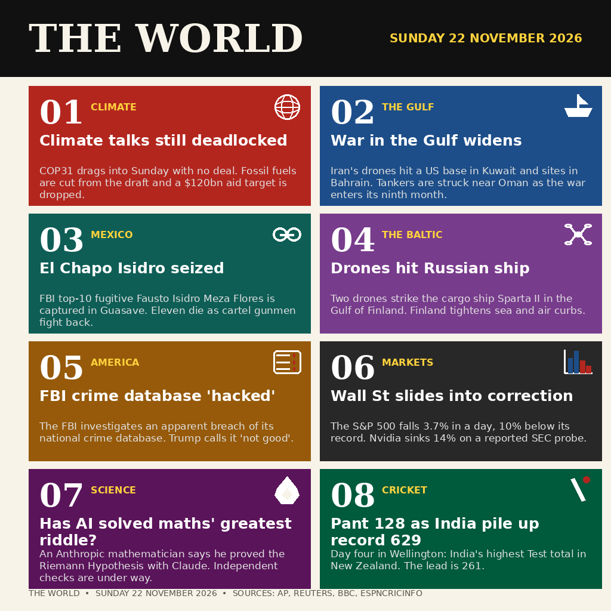

# The World — Sunday 22 November 2026

[](https://make.fun/bounty/news-image-20261122?utm_source=github&utm_medium=readme&utm_campaign=news-image-20261122)
[](https://make.fun/bounty/news-image-20261122/leaderboard?utm_source=github&utm_medium=readme&utm_campaign=news-image-20261122)
[](https://make.fun/bounty/news-image-20261122?utm_source=github&utm_medium=readme&utm_campaign=news-image-20261122)

A one-page newspaper front page summing up the world news of
**Sunday 22 November 2026** in a single image.



## What the image shows

The front page of "THE WORLD", dated Sunday 22 November 2026, with
eight verified stories from the day:

1. **Climate talks still deadlocked** — COP31 drags into Sunday with no
   deal. Fossil fuels are cut from the draft and a $120bn aid target is
   dropped. (AP / BBC)
2. **War in the Gulf widens** — Iran's drones hit a US base in Kuwait and
   sites in Bahrain. Tankers are struck near Oman as the war enters its
   ninth month. (AP / Reuters)
3. **El Chapo Isidro seized** — FBI top-10 fugitive Fausto Isidro Meza
   Flores is captured in Guasave. Eleven die as cartel gunmen fight
   back. (AP / Reuters)
4. **Drones hit Russian ship** — Two drones strike the cargo ship Sparta II
   in the Gulf of Finland. Finland tightens sea and air curbs.
   (Reuters / Euronews)
5. **FBI crime database 'hacked'** — The FBI investigates an apparent
   breach of its national crime database. Trump calls it "not good". (AP)
6. **Wall St slides into correction** — The S&P 500 falls 3.7% in a day,
   10% below its record. Nvidia sinks 14% on a reported SEC probe.
   (AP / Reuters)
7. **Has AI solved maths' greatest riddle?** — An Anthropic mathematician
   says he proved the Riemann Hypothesis with Claude. Independent checks
   are under way. (Scientific American)
8. **Pant 128 as India pile up record 629** — Day four in Wellington:
   India's highest Test total in New Zealand. The lead is 261.
   (ESPNcricinfo, 22 November 2026)

Every story was checked against reporting dated to the weekend of
21–22 November 2026; the Riemann claim is worded as a claim, not a
confirmed proof, and no story predates 20 November 2026. The cricket
story (Pant's 128, India's record total) is from play on Sunday
22 November itself.

## How it works

`main.py` (Python 3.13, standard library only) writes the image to
`/output/entry.png`. It copies the front-page image held in the
repository, so it needs no network and is deterministic: every
run writes the same bytes.

Run it:

```sh
mkdir -p out && MAKEFUN_OUTPUT_DIR=out python3 main.py
```

## Files

- `main.py` — the entry program (stdlib only)
- `entry.png` — the front-page image (1024×1024, 138,863 bytes)
- `gen_variants.py` — the renderer that drew the three variants
- `build.py` — embeds the chosen image into `main.py`
- `variants/` — the three variants built (vA broadsheet, vB magazine
  cover, vC colour grid — vC chosen)
- `NOTES.md` — build notes, sources and verification

## Entry

- Competition: [news-image-20261122](https://make.fun/bounty/news-image-20261122)
  ("Sum up 22 November's world news in one image", $100, top 50 share)
- Repository: `Van7art/news-image-20261122-entry`
- License: MIT
